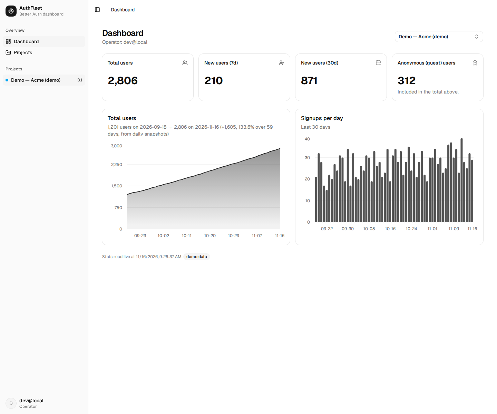
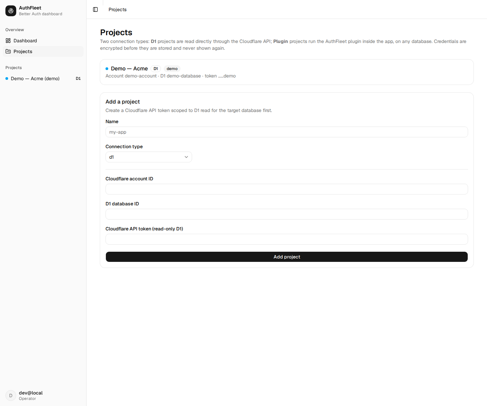

# AuthFleet

[English](README.md) | **日本語** | [简体中文](README.zh-CN.md)

> **⚠️ 開発中 — 本番環境での利用は推奨しません。** AuthFleet は 1.0 未満で、
> 現在も開発の途中です。API やデータ形式は、予告なく変わることがあります。
> 評価やセルフホストでの試用にとどめ、本番の認証データを預ける使い方は
> まだ避けてください。

**すべての Better Auth アプリを、ひとつのダッシュボードで。Cloudflare にセルフホストできます。**

自分の Better Auth プロジェクトを複数登録して、ひとつのダッシュボードで
切り替えながら、各プロジェクトのユーザー数と推移を確認できます。
AuthFleet はオープンソースで、すべて自分の Cloudflare アカウントの中で動きます。

なぜ作ったか：Better Auth 公式の Infrastructure ダッシュボードはホスト型の
SaaS で（オープンソースではなく）、OSS の管理 UI である Better Auth Studio は
アプリごとに埋め込む形です。セルフホストできて、複数プロジェクトを切り替えて
見られるものが無かったので作りました。

## スクリーンショット

ダッシュボード — 内蔵のデモプロジェクト（`AUTHFLEET_DEMO=1`）の表示例（サンプルデータ）:



プロジェクト画面 — プロジェクトの登録と、プラグイン／D1 の接続管理（デモプロジェクト、サンプルデータ）:



## アーキテクチャ

```
                Cloudflare Access（運用者のログイン）
                            │
                            ▼
┌──────────────────────────────┐   サービスバインディング ┌──────────────────────────────┐
│ apps/web                     │ ──────────────────▶ │ apps/api                     │
│ TanStack Start + shadcn/ui   │   （公開経路なし）    │ Hono Worker                  │
│ - プロジェクト切り替え        │                     │ - workers_dev = false        │
│ - Access JWT を検証し、      │                     │ - ルートなし／ドメインなし    │
│   運用者のメールを api へ    │                     │ - 日次スナップショットの cron │
│   転送する                   │                     │                              │
└──────────────────────────────┘                     └──────────────┬───────────────┘
                                                                  │
                                          レジストリ D1 (Drizzle)  │  Cloudflare D1 HTTP
                                          - projects（認証情報は │  クエリ API、プロジェクト
                                            AES-GCM で暗号化）    │  ごとの読み取り専用トークン
                                          - snapshots             ▼
                                                    対象プロジェクトの D1 データベース（d1 プロジェクト）
                                                    （Better Auth の `user` テーブルを集計）
                                                                  │  HTTPS + プロジェクト
                                                                  │  ごとの Bearer API キー
                                                                  ▼
                                                    プラグインを入れた対象アプリ（agent プロジェクト）
                                                    （件数はアプリ自身が返す。DB は何でも可）
```

- `apps/api` — Workers 上の Hono。レジストリの CRUD、統計、日次スナップ
  ショットの定期ジョブを持ちます。すべての認証情報を抱えるので、**公開しません**
  （セキュリティモデル参照）。
- `apps/web` — Cloudflare Access の内側に置く TanStack Start のダッシュボード。
- `packages/core` — 両者が共有する、フレームワークに依存しないロジック：
  小文字 ULID の ID、AES-GCM による認証情報の暗号化（WebCrypto）、リモート
  D1 リーダー、プラグイン向け HTTP リーダー、統計計算、スナップショット
  ジョブ、デモ用フィクスチャ。2 つのリーダーは共通の
  `ProjectStatsReader` 契約を実装しているので、統計・スナップショット・
  ダッシュボードの振る舞いはどちらのプロジェクト種別でも同じになります。
- `packages/plugin` — npm パッケージ `authfleet`。対象アプリに入れる、
  読み取り専用の Better Auth プラグインです（下記「プロジェクトの接続」参照）。
- `apps/mcp` — 計画のみで未実装です（ロードマップ参照）。

プロジェクトごとに表示するデータ：Better Auth の `user` テーブルの総ユーザー数、
作成日時から集計した日別の登録数、直近 7 日／30 日の新規ユーザー数、
ユーザーデータに匿名フラグがある場合は匿名（ゲスト）ユーザー数、そして
api の cron が毎日取るスナップショットから計算した推移です。中心となる操作は
プロジェクトの切り替えで、プロジェクト横断の合計はあえて対象外にしています。

## プロジェクトの接続

接続方式は 2 種類あり、プロジェクトの登録時に選びます。

**D1 プロジェクト**（アプリが Cloudflare D1 を使っている場合）：
Cloudflare のアカウント ID、D1 のデータベース ID、そしてそのデータベース
だけの D1 読み取りにスコープした Cloudflare API トークンを登録します。
対象アプリ側の変更は要りません。

**プラグインプロジェクト**（それ以外のデータベース — Postgres、MySQL、
SQLite など）：対象アプリに AuthFleet プラグインを入れます。プラグインは
アプリ内の読み取り専用エンドポイントから同じ件数を返し、読み取りはアプリ
自身の Better Auth DB アダプタ経由なので、Better Auth が対応する
データベースなら何でも動きます。

```bash
npm install authfleet
```

```ts
import { betterAuth } from "better-auth";
import { authfleet } from "authfleet";

export const auth = betterAuth({
  plugins: [
    authfleet({
      apiKeyHash: process.env.AUTHFLEET_API_KEY_HASH,
    }),
  ],
});
```

プロジェクト用の API キーはダッシュボードで生成します（プロジェクト →
プロジェクト追加 → Plugin →「Generate a key」）。キーは**一度だけ**表示
され、その SHA-256 ハッシュも一緒に渡されます。アプリ側の環境変数
`AUTHFLEET_API_KEY_HASH` にはハッシュを設定してください。アプリが持つのは
ハッシュだけで、キーそのものは持ちません。あとはアプリの Better Auth
ベース URL（オリジン + ベースパス。例：`https://example.com/api/auth`）と
同じキーをダッシュボードに登録します。登録時には保存前にプラグインの
`GET /authfleet/validate` で接続確認をするので、URL やキーの間違いは
その場で具体的なエラーになります。

プラグインは**件数のみ・読み取り専用**です。ユーザーの行・メール・ID を
返すエンドポイントはなく、アプリのデータベースへ書き込むこともなく、
開発用バイパスもありません（ローカル開発では使い捨ての本物のキーを使って
ください）。詳細と脅威メモは `packages/plugin/README.md` にあります。

## セキュリティモデル

デプロイする前に読んでください。AuthFleet は他のプロジェクトの認証情報を
預かるので、自身の守りが要になります。

- **api は公開経路を持ちません。** `apps/api/wrangler.jsonc` は
  `workers_dev: false` を設定し、**ルートを定義していません**。入る方法は
  `apps/web` からの Cloudflare **サービスバインディング**
  （`services: [{ binding: "API", service: "authfleet-api" }]`）だけです。
  バインディング経由の呼び出しは公開インターネットを通りません。web 側も
  `workers_dev: false` なので、到達できるのは Access アプリケーションが
  カバーするカスタムドメインだけです。
- **運用者の本人確認を検証したうえで、api の全呼び出しに必須とします。**
  web は Cloudflare Access の JWT（`Cf-Access-Jwt-Assertion`）をチームの
  JWKS で検証し（署名・オーディエンス・有効期限）、**検証済みクレームに
  入っているメール** を `x-authfleet-operator` として転送します。平文の
  `Cf-Access-Authenticated-User-Email` ヘッダーは決して信用しません
  （Access を経由せず Worker に届く経路では偽装できるため）。検証の設定は
  web Worker の `AUTHFLEET_ACCESS_TEAM_DOMAIN` と `AUTHFLEET_ACCESS_AUD`
  で行います。Access が設定されているのに JWT が無い・無効な場合は
  失敗側に倒します（fail closed）。api は、メール形式でない運用者 ID の
  `/api/*` 呼び出しを 401 で拒否します。api Worker の必須設定
  `AUTHFLEET_OPERATOR_EMAILS`（カンマ区切り）が未設定または空なら、
  明示的なローカル開発バイパス以外ではすべての `/api/*` に 503 を返します。
  設定済みなら、Access のポリシーが通した相手でも
  許可リスト外を 403 で拒否します。運用者 ID はレスポンスに echo しません。
- **認証情報は暗号化して保存します。** 各プロジェクトの認証情報
  （`d1` プロジェクトでは Cloudflare API トークン、`agent` プロジェクト
  ではプラグインの API キー）は、D1 に触れる前に AES-GCM で暗号化します
  （WebCrypto、`TOKEN_ENCRYPTION_KEY` シークレット由来の 256 ビット鍵、
  レコードごとにランダムな IV）。さらに暗号文は AES-GCM の AAD で
  プロジェクトの行に紐づいているため、別のプロジェクトの行に暗号文を
  コピーしても復号できません。API が認証情報を返すことはなく（末尾 4 文字の
  ヒントのみ）、ログにも出しません。
- **読み取りはどちらの経路でも読み取り専用です。** `d1` プロジェクトには、
  そのデータベースだけの D1 読み取りにスコープした Cloudflare API
  トークンを登録してください。AuthFleet の core は単一文の `SELECT` のみの
  クエリをコード側で強制している（規約ではなく実装で）ので、誤って対象
  プロジェクトを書き換えることも構造的にありません。`agent` プラグインは
  設計として読み取り専用・件数のみで、対象アプリはキーの SHA-256
  ハッシュだけを持ち、プラグインは定数時間で比較します。
- **agent のベース URL は HTTPS のみです**（ローカル開発時の localhost
  だけ HTTP を許可）。登録時には保存前にプラグインを確認し、プラグインが
  無い・届かない・契約バージョンが合わないプロジェクトは、その状態として
  区別して表示します。「ユーザー 0 人」と取り違えることはありません。
- **エラーで上流の詳細を漏らしません。** 対象の読み取りが失敗したとき、
  api がダッシュボードに返すのは汎用的なエラーだけです。Cloudflare の
  エラーコードやメッセージはサーバー側のログにだけ残ります。
- **ID は秘密ではありません。** 行の ID は小文字 ULID で、アクセス権に
  なるものはすべて高エントロピーの乱数を使います。ULID は決して秘密には
  使いません。
- **開発用バイパスはローカル専用です。** `AUTHFLEET_DEV_BYPASS=1` を
  設定すると、api は Access の本人確認なしの呼び出しを受け付けます
  （`AUTHFLEET_DEV_OPERATOR` を使用）。これは手元で `wrangler dev` を
  動かすためのものです。web に Access の検証が設定されていれば無効で、
  どちらの Worker のコミット済み設定にもこのフラグは含まれていません。
  **本番では絶対に設定しないでください。**

## スタック

pnpm モノレポ · Hono · TanStack Start · shadcn/ui（Base UI ベース、
neutral）· Cloudflare Workers + D1 · Drizzle ORM · Biome · Vitest ·
Turbo · OpenSpec（`openspec/`）— 振る舞いを変える前に仕様を書きます。

## ローカル開発

前提：Node ≥ 22、pnpm 10。

```bash
pnpm install

# 1. api（ターミナル A）
cd apps/api
cp .dev.vars.example .dev.vars   # TOKEN_ENCRYPTION_KEY を設定（openssl rand -base64 32）
pnpm db:migrate:local            # ローカルのレジストリ D1 を作る
pnpm dev                         # http://127.0.0.1:8788 で wrangler dev

# 2. web（ターミナル B）
cd apps/web
AUTHFLEET_DEV_BYPASS=1 AUTHFLEET_API_URL=http://127.0.0.1:8788 pnpm dev
# → http://127.0.0.1:3000
```

`.dev.vars.example` はデフォルトでデモモード（`AUTHFLEET_DEMO=1`）を
有効化しているので、本物のプロジェクトを登録する前でも、決定的な
ダミーデータのフィクスチャプロジェクト（"Demo — Acme"）がダッシュボードに
表示されます。

チェック：`pnpm typecheck`、`pnpm test`、`pnpm lint`、`pnpm build`、
`pnpm spec:validate`。

## デプロイ

前提：Node ≥22、pnpm 10、`pnpm install` 済みで、Workers・D1 の作成と
シークレット設定ができる Cloudflare アカウントが必要です。ローカルでは
`pnpm --filter @authfleet/api exec wrangler login`、CI では
`CLOUDFLARE_API_TOKEN` と `CLOUDFLARE_ACCOUNT_ID` で認証します。
web のカスタムドメインを決め、Zero Trust → Access → Applications で
セルフホスト型アプリを作成し、オーディエンスを取得してください。

```bash
pnpm run deploy
```

`pnpm deploy` は pnpm 自体のコマンドなので、必ず **`pnpm run deploy`** を使います。
認証確認 → ビルド → api デプロイ → 不足シークレット設定 → web デプロイを行います。
Wrangler が `authfleet-registry` D1 を自動作成または再利用し、マイグレーションは
実行時に適用されます。既存シークレットは変更せず、値も表示しません。
`TOKEN_ENCRYPTION_KEY` が存在しない場合だけ 32 バイトのランダム鍵を base64 で生成します。
鍵は安全にバックアップしてください。紛失・置換すると保存済み認証情報を復号できません。

不足設定は対話入力します。非対話環境では、対応するシークレットが未設定の場合に
以下の環境変数が必要です。

| 変数                           | 値                                     |
| ------------------------------ | -------------------------------------- |
| `AUTHFLEET_OPERATOR_EMAILS`    | 運用者メール（カンマ区切り、api 必須） |
| `AUTHFLEET_ACCESS_TEAM_DOMAIN` | 例：`your-team.cloudflareaccess.com`   |
| `AUTHFLEET_ACCESS_AUD`         | Access アプリ概要のオーディエンス      |

更新時も既存シークレットが環境変数より優先されます。設定を意図的に変更する場合は、
各 app ディレクトリで `wrangler secret put NAME` を使います。既存の暗号化鍵は変更しないでください。
Access 設定を通常の Worker vars で管理していた場合は、同じ値を一度入力してシークレットに移行します。
本番では `AUTHFLEET_DEV_BYPASS` を設定しないでください。

**Cloudflare 側の手動作業：** カスタムドメインを `authfleet-web` に紐付け、同じドメインを
Access アプリで保護し、運用者だけを許可します。チームドメインとオーディエンスを web 設定と
一致させてください。両 Worker の `workers.dev` は無効のままで、api はサービスバインディング専用です。

## 更新

レジストリをバックアップし、DB 名と暗号化鍵を維持したまま実行します。

```bash
git pull && pnpm install && pnpm run deploy
```

同じコマンドを繰り返し実行できます。既存シークレットを保持し、デプロイ後最初の API リクエスト
（または定期ジョブ）の前に未適用マイグレーションを自動適用します。
`pnpm --filter @authfleet/api db:migrate:remote` は任意の手動経路として残りますが、必須ではありません。
失敗時は詳細をサーバーログに記録し、汎用 503 を返して次回再試行します。`/health` は影響を受けません。

スキーマ変更時は `pnpm --filter @authfleet/api db:generate` で SQL と静的バンドルを生成します。
SQL を別途追加した場合は `pnpm --filter @authfleet/api db:bundle` を実行し、SQL と
`apps/api/src/db/migrations.generated.ts` を一緒にコミットします。テストが不一致を検出します。
履歴は Wrangler 互換の `d1_migrations` に記録されます。適用済み SQL は編集せず、新規追加してください。

## ロードマップ

- **エージェントプラグイン**：実装済みです（`packages/plugin`、エンド
  ポイント契約 v1、Better Auth 1.7.16 と 1.7.25 でテスト済み）。残る工程は
  第 2 ラウンドのセキュリティ監査で、これが npm への初回公開の前提に
  なります。
- `apps/mcp`：同じ core の上に作る読み取り専用の MCP サーバー（AI に
  「自分のアプリ、今何人？」と聞けるようにするもの）。設計判断として
  v1 からは外しました。
- プロジェクトごとの書き込み操作（BAN／削除）を、明示的な確認を挟んで
  任意で提供 — 需要が出た場合のみ。v1 は設計として読み取り専用です。

## リリース

npm の trusted publishing を使い、`main` 上の GitHub Actions「Publish to npm」を手動実行します。
npmjs.com のパッケージ設定で `kai-natori/authfleet`、`publish.yml` を trusted publisher として登録し、
`npm publish` を許可してください。Node 24、npm ≥11.5.1、`id-token: write` を使用し、
`NODE_AUTH_TOKEN` と `--provenance` は不要です（provenance は自動生成）。動作確認後に
`NPM_TOKEN` リポジトリシークレットを削除できます。信頼設定には既存パッケージが必要なので、
初回だけ管理者が npm 認証で公開し、その後に trusted publisher を設定します。
詳細と npm ドキュメントへのリンクは英語版 README の「Releasing」を参照してください。
