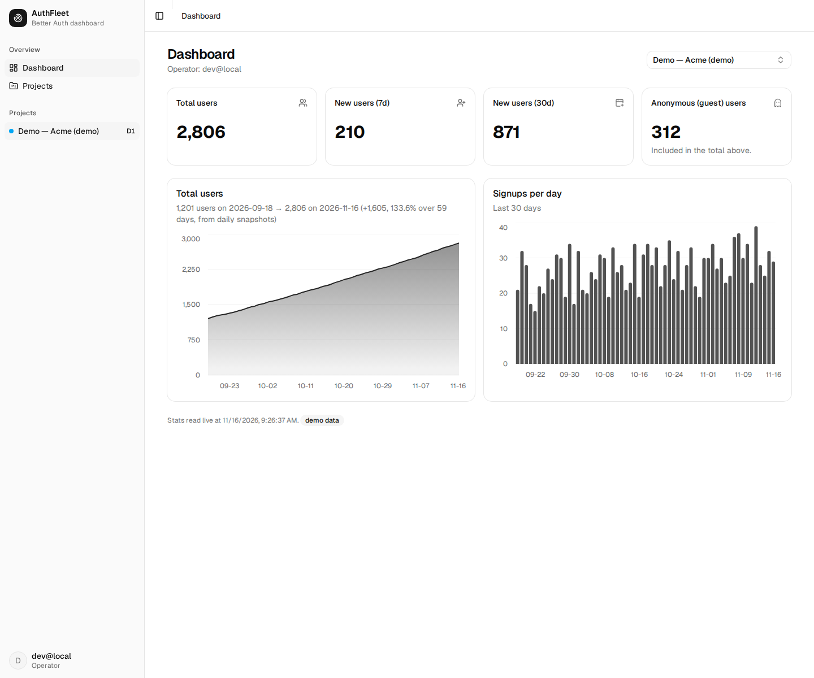
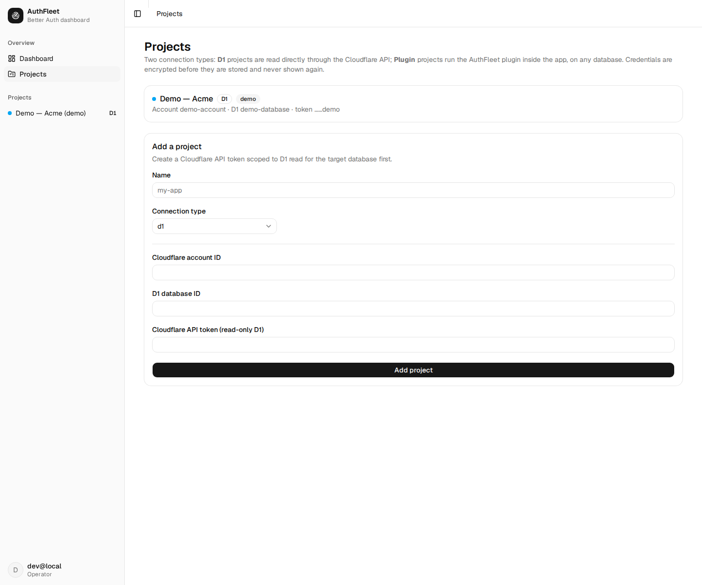

# AuthFleet

**English** | [日本語](README.ja.md) | [简体中文](README.zh-CN.md)

> **⚠️ In development — not recommended for production use.** AuthFleet is
> pre-1.0 and under active development. APIs and data formats may change
> without notice. Use it for evaluation and self-hosted experiments; do not
> rely on it for production authentication data yet.

**One dashboard for all your Better Auth apps — self-hosted on Cloudflare.**

Register several of your own Better Auth projects and switch between them
in one dashboard to see each project's user counts and growth. AuthFleet
is open source and runs entirely in your own Cloudflare account.

Why: Better Auth's official Infrastructure dashboard is a hosted SaaS
(not open source), and the OSS admin UI (Better Auth Studio) is embedded
per app. Nobody offered a self-hosted, multi-project switcher — so this
exists.

## Screenshots

Dashboard — the built-in demo project (`AUTHFLEET_DEMO=1`), sample data:



Projects — registration and plugin/D1 connections (demo project, sample data):



## Architecture

```
                Cloudflare Access (operator login)
                            │
                            ▼
┌──────────────────────────────┐   service binding   ┌──────────────────────────────┐
│ apps/web                     │ ──────────────────▶ │ apps/api                     │
│ TanStack Start + shadcn/ui   │   (no public path)  │ Hono Worker                  │
│ - project switcher           │                     │ - workers_dev = false        │
│ - verifies the Access JWT    │                     │ - no routes / no domain      │
│   and forwards the operator  │                     │ - daily snapshot cron        │
│   email on every api call    │                     │                              │
└──────────────────────────────┘                     └──────────────┬───────────────┘
                                                                  │
                                          registry D1 (Drizzle)   │  Cloudflare D1 HTTP
                                          - projects (credential  │  query API, per-project
                                            AES-GCM encrypted)    │  read-only token
                                          - snapshots             ▼
                                                    target projects' D1 databases  (d1 projects)
                                                    (Better Auth `user` table counts)
                                                                  │  HTTPS + per-project
                                                                  │  Bearer API key
                                                                  ▼
                                                    target apps running the plugin  (agent projects)
                                                    (counts served by the app itself, any database)
```

- `apps/api` — Hono on Workers. Registry CRUD, stats, and the scheduled
  snapshot job. Holds every credential; therefore it is **not public**
  (see the security model).
- `apps/web` — TanStack Start dashboard behind Cloudflare Access.
- `packages/core` — framework-free logic shared by both: lowercase-ULID
  ids, AES-GCM credential encryption (WebCrypto), the remote D1 reader,
  the plugin HTTP reader, stats math, the snapshot job, demo fixtures.
  Both readers implement one `ProjectStatsReader` contract, so stats,
  snapshots and the dashboard behave identically for both project types.
- `packages/plugin` — the `authfleet` npm package: a read-only Better
  Auth plugin for target apps (see "Connecting a project" below).
- `apps/mcp` — planned, not built yet (see Roadmap).

Data per project: total users in the Better Auth `user` table, signups
per day from the creation timestamp, new users (7d / 30d), the
anonymous/guest count when the user data has an anonymous flag, and
growth from daily snapshots taken by the api cron. Switching projects
is the core interaction; combined cross-project totals are intentionally
out of scope.

## Connecting a project

There are two connection types; choose per project when you register it.

**D1 projects** (the app uses Cloudflare D1): register the Cloudflare
account id, the D1 database id, and a Cloudflare API token scoped to
D1 read for that one database. Nothing changes in the target app.

**Plugin projects** (any other database — Postgres, MySQL, SQLite, …):
install the AuthFleet plugin in the target app. It serves the same
counts through two read-only endpoints inside the app, reading through
the app's own Better Auth DB adapter, so it works on any database
Better Auth supports.

```bash
npm install authfleet
```

```ts
import { betterAuth } from "better-auth";
import { authfleet } from "authfleet";

export const auth = betterAuth({
  plugins: [
    authfleet({
      apiKeyHash: process.env.AUTHFLEET_API_KEY_HASH,
    }),
  ],
});
```

Generate a project API key in the dashboard (Projects → Add project →
Plugin → "Generate a key"). The dashboard shows the key **once** and
gives you its SHA-256 hash: set `AUTHFLEET_API_KEY_HASH` to that hash
in the app's environment — the app only ever holds the hash, never the
key. Then register the project with the app's Better Auth base URL
(origin + base path, e.g. `https://example.com/api/auth`) and the same
key. Registration calls the plugin's `GET /authfleet/validate` before
saving, so a wrong URL or key fails immediately with a specific error.

The plugin is **counts-only and read-only**: no endpoint returns user
rows, emails or ids; it never writes to the app's database; and there
is no dev-mode bypass (use a real throwaway key locally). Full details
and threat notes: `packages/plugin/README.md`.

## Security model

Read this before deploying — AuthFleet stores credentials for your other
projects, so its own posture matters.

- **Api has no public exposure.** `apps/api/wrangler.jsonc` sets
  `workers_dev: false` and defines **no routes**. The only way in is the
  Cloudflare **service binding** from `apps/web`
  (`services: [{ binding: "API", service: "authfleet-api" }]`).
  Service-binding calls never traverse the public internet. Web also
  sets `workers_dev: false`, so it is only reachable on the custom
  domain your Access application covers.
- **Operator identity is verified, then required on every api call.**
  Web verifies the Cloudflare Access JWT (`Cf-Access-Jwt-Assertion`)
  against your team JWKS — signature, audience and expiry — and
  forwards the email **from the verified claims** as
  `x-authfleet-operator`. The plain
  `Cf-Access-Authenticated-User-Email` header is never trusted (it is
  spoofable wherever a request reaches the Worker without traversing
  Access). Configure verification with `AUTHFLEET_ACCESS_TEAM_DOMAIN`
  and `AUTHFLEET_ACCESS_AUD` on the web Worker; when Access is
  configured, a missing or invalid JWT fails closed. Api rejects
  `/api/*` calls with 503 when `AUTHFLEET_OPERATOR_EMAILS` is unset or
  empty (unless the explicit local dev bypass is enabled). This required
  api Worker setting is comma-separated. With it configured, the api
  rejects calls without an email-shaped operator identity with 401 and anyone outside
  that allowlist with 403, whatever the Access policy admits. The api
  does not echo the operator identity in responses.
- **Credentials are encrypted at rest.** Each project's credential —
  the Cloudflare API token for `d1` projects, the plugin API key for
  `agent` projects — is encrypted with AES-GCM (WebCrypto, 256-bit key
  from the `TOKEN_ENCRYPTION_KEY` Worker secret, random IV per record)
  before it touches D1. The ciphertext is additionally bound to its
  project row via AES-GCM AAD, so a ciphertext copied into another
  project's row does not decrypt. The API never returns a credential —
  only a last-4 hint — and credentials are never logged.
- **Reads are read-only on both paths.** Register each `d1` project
  with a Cloudflare API token scoped to D1 read for that one database;
  AuthFleet core enforces single-statement `SELECT`-only queries in
  code (not just by convention), so it cannot mutate a target project
  even by accident. The `agent` plugin is read-only and counts-only by
  design, and the target app holds only a SHA-256 hash of its key,
  which the plugin compares in constant time.
- **Agent base URLs require HTTPS, with an HTTP exception for localhost.**
  The exception is intended for local development but is not gated by the
  runtime environment; use HTTPS for production connections. Registration verifies the plugin
  before saving, and a project whose plugin is absent, unreachable or
  on an unsupported contract version is shown as that distinct state —
  never as a zero-user project.
- **Errors don't leak upstream detail.** When a target read fails, api
  returns a generic error to the dashboard; Cloudflare's error codes
  and messages stay in server-side logs only.
- **IDs are not secrets.** Row ids are lowercase ULIDs; anything that
  grants access uses high-entropy randomness, never a ULID.
- **Dev bypass is local-only.** `AUTHFLEET_DEV_BYPASS=1` makes api accept
  calls without an Access identity (using `AUTHFLEET_DEV_OPERATOR`).
  It exists so `wrangler dev` works on your machine. It is inert
  whenever Access verification is configured on web, and neither
  Worker's committed config contains the flag. **Never set it in
  production.**

## Stack

pnpm monorepo · Hono · TanStack Start · shadcn/ui (Base UI base,
neutral) · Cloudflare Workers + D1 · Drizzle ORM · Biome · Vitest ·
Turbo · OpenSpec (`openspec/`) — specs before behaviour changes.

## Local development

Prerequisites: Node ≥ 22, pnpm 10.

```bash
pnpm install

# 1. api (terminal A)
cd apps/api
cp .dev.vars.example .dev.vars   # set TOKEN_ENCRYPTION_KEY (openssl rand -base64 32)
pnpm db:migrate:local            # creates the local registry D1
pnpm dev                         # wrangler dev on http://127.0.0.1:8788

# 2. web (terminal B)
cd apps/web
AUTHFLEET_DEV_BYPASS=1 AUTHFLEET_API_URL=http://127.0.0.1:8788 pnpm dev
# → http://127.0.0.1:3000
```

`.dev.vars.example` enables demo mode (`AUTHFLEET_DEMO=1`) by default, so
the dashboard shows a fixture project ("Demo — Acme") with deterministic
fake data before you register any real project.

Checks: `pnpm check` runs typecheck, unit tests, lint, build and strict spec
validation. The HTTP end-to-end fixture is excluded from `pnpm test:unit`;
`pnpm test` includes it and is reserved for operator runtime verification.

## Deploy

Prerequisites: Node ≥22, pnpm 10, installed dependencies (`pnpm install`),
and a Cloudflare account with Workers, D1 and the required provisioning/secret
permissions. Authenticate with `pnpm --filter @authfleet/api exec wrangler login`
locally, or set `CLOUDFLARE_API_TOKEN` and `CLOUDFLARE_ACCOUNT_ID` in CI.
Choose your web custom domain and create a self-hosted Cloudflare Access
application for it (Zero Trust → Access → Applications) to obtain its audience.

```bash
pnpm run deploy
```

Use **`pnpm run deploy`**, not `pnpm deploy` (which is a pnpm builtin).
The command checks Wrangler authentication, builds the workspace, deploys API
(provisioning or reusing `authfleet-registry` D1), configures missing secrets,
then deploys web. API schema migrations run automatically at runtime.
It never prints secret values or rotates existing secrets. It generates a
32-byte base64 `TOKEN_ENCRYPTION_KEY` only when that secret name is absent.
Back up the key securely; losing or replacing it orphans encrypted credentials.
The automatically generated key is written directly to the Worker secret and
is not exported; Cloudflare does not return its value later. To keep a recoverable
copy, generate a 32-byte base64 key yourself, save it in your secret manager,
and run `pnpm --filter @authfleet/api exec wrangler secret put TOKEN_ENCRYPTION_KEY`
to enter it **before the first deployment**. The deployment script preserves
that existing secret. For an existing registry, only restore its original key;
do not replace it with a newly generated one.

Missing settings are prompted for interactively. For non-interactive deployment,
provide these environment variables when the corresponding Worker secret is absent:

| Variable                       | Value                                             |
| ------------------------------ | ------------------------------------------------- |
| `AUTHFLEET_OPERATOR_EMAILS`    | Operator emails, comma-separated; required by API |
| `AUTHFLEET_ACCESS_TEAM_DOMAIN` | e.g. `your-team.cloudflareaccess.com`             |
| `AUTHFLEET_ACCESS_AUD`         | Audience from the Access application overview     |

Existing secret names take precedence over environment values, including on updates.
To intentionally change settings, use `wrangler secret put NAME` in the relevant
app directory; do not rotate the encryption key on an existing registry.
The script manages these settings as secrets. If an existing installation uses
plain Worker vars for Access settings, supply their values once to migrate them.
Never enable `AUTHFLEET_DEV_BYPASS` in production.

**Manual Cloudflare step:** attach the custom domain to `authfleet-web` and ensure
the Access application protects that exact domain with an allow policy for your
operators only. Its team domain and audience must match the web settings.
Both Workers keep `workers.dev` disabled; API remains service-binding-only.

### GitHub Actions deployment

The **Deploy to Cloudflare** workflow runs the repository checks before using
the same deployment script. Configure the `production` GitHub environment:

- Secrets: `CLOUDFLARE_API_TOKEN` (scoped to the intended account's Workers
  deployment, D1 provisioning and Worker secret operations) and
  `AUTHFLEET_OPERATOR_EMAILS`.
- Variables: `CLOUDFLARE_ACCOUNT_ID`, `AUTHFLEET_ACCESS_TEAM_DOMAIN` and
  `AUTHFLEET_ACCESS_AUD`.

Run it manually from `main` for the initial deployment. After verifying the
domain and Access policy, set the **repository** variable
`AUTHFLEET_DEPLOY_ENABLED=true` to deploy automatically on main pushes.
Deployments are serialized. Missing non-interactive configuration fails before
deploying a Worker. Existing Worker secrets still take precedence.

## Updating

Back up the registry and keep its database name and encryption key unchanged, then:

```bash
git pull && pnpm install && pnpm run deploy
```

This is the same idempotent deployment command: existing secrets are preserved,
and pending migrations apply automatically on the first API request after deploy
(or before scheduled snapshots). Failed migration initialization
returns a generic 503 and is retried on the next request; `/health` remains available.

### Registry migrations

The API applies bundled registry migrations before authenticated `/api/*`
requests and scheduled snapshots, once per isolate/database. `/health` does
not initialize the registry. Migration failures return a generic 503 and are
retried on the next request; details stay in server-side logs. Migration names
are recorded in Wrangler's `d1_migrations` table, so existing CLI-migrated
installations are recognized.

**Use runtime migrations for upgrades.** The runner preserves snapshots when
applying legacy migration `0001_lazy_cloak.sql`, whose project-table rebuild
otherwise triggers D1's cascading deletes. Preservation, restoration and history
are one atomic batch. The old `db:migrate:remote` shortcut has been removed:
applying that legacy SQL directly with Wrangler does not include this safeguard.
If it was already applied and snapshots were lost, restore from a registry backup;
the new runner cannot reconstruct deleted history. The local CLI migration command
above is for a fresh development database.

After changing the Drizzle schema, run `pnpm --filter @authfleet/api db:generate`.
This generates SQL and refreshes the static Worker migration bundle. If SQL files
are added separately, run `pnpm --filter @authfleet/api db:bundle`. Commit the SQL
and `src/db/migrations.generated.ts` together; a test detects bundle drift.
Do not edit migrations that have already been applied; add a new migration.

## Roadmap

- **Agent plugin**: implemented (`packages/plugin`, endpoint contract
  v1, tested against Better Auth 1.7.16 and 1.7.25). The pre-publication audit is
  complete; current findings and outstanding installation checks are recorded
  in `SECURITY-AUDIT.md`. See `CHANGELOG.md` for release changes.
- `apps/mcp`: a read-only MCP server over the same core (ask your AI
  "how many users does my app have?") — deferred from v1 by design.
- Optional write actions per project (ban/delete) behind explicit
  confirmation — only if demand appears; v1 is read-only by design.

Deployment-specific checks remain in the
[operator verification checklist](docs/operator-verification.md).
They have not been performed for this release.

## Releasing

Releases use npm trusted publishing from the manually dispatched **Publish to npm**
workflow (`.github/workflows/publish.yml`), restricted to `main`. In the npm package's
settings, configure a GitHub Actions trusted publisher for `kai-natori/authfleet`,
workflow filename `publish.yml`, allowing direct `npm publish`. The workflow uses
Node 24, npm ≥11.5.1 and `id-token: write`; no `NODE_AUTH_TOKEN` or `--provenance`
is needed (provenance is automatic). Delete the old `NPM_TOKEN` repository secret
after verifying trusted publishing works.

Before publishing, update `packages/plugin/package.json` to an unused version
and record changes in `CHANGELOG.md`. The workflow requires successful repository
checks and a production dependency audit, builds the plugin and inspects its
package contents before publishing. Release jobs are serialized.
Version 0.2.0 requires Better Auth 1.7.16 or newer; update older hosts first.

The package must already exist before trust can be configured. For the first-ever
publish only, a maintainer must bootstrap it with authenticated npm publishing,
then configure trust and use Actions for subsequent releases. See
[npm trusted publishing](https://docs.npmjs.com/trusted-publishers/) and
[package prerequisite](https://docs.npmjs.com/cli/v11/commands/npm-trust/#prerequisites).
