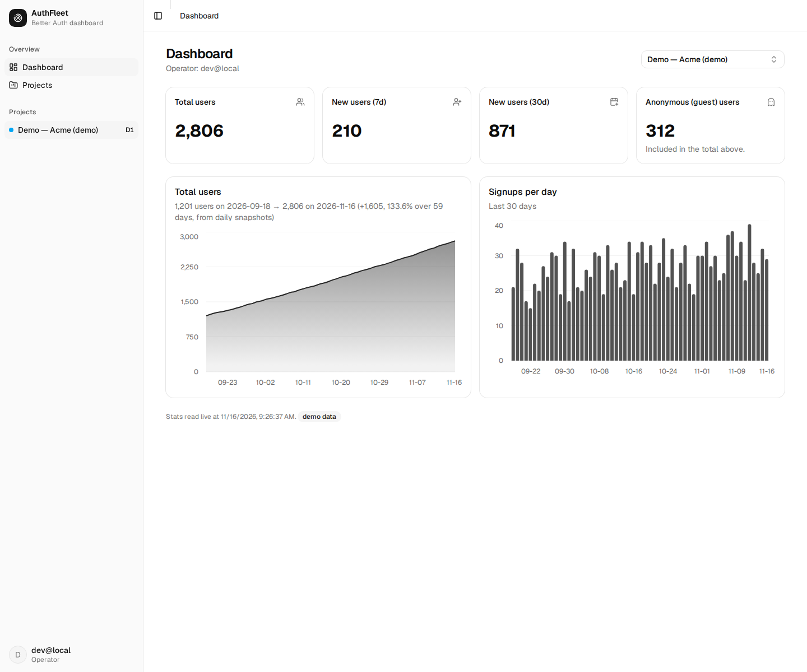
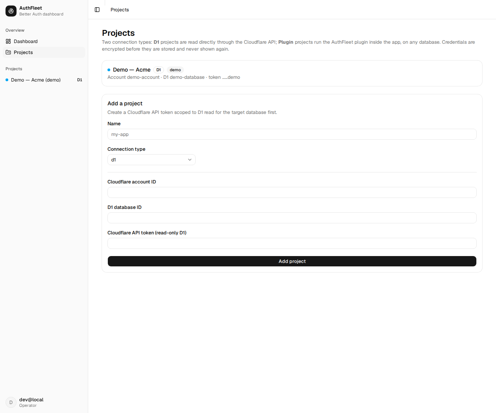

# AuthFleet

[English](README.md) | [日本語](README.ja.md) | **简体中文**

> **⚠️ 开发中——不建议用于生产环境。** AuthFleet 尚未发布 1.0，仍在积极
> 开发中，API 与数据格式可能随时变更，恕不另行通知。请仅将其用于评估和
> 自托管实验，暂时不要用它承载生产环境的认证数据。

**用一个仪表盘管理你所有的 Better Auth 应用——自托管在 Cloudflare 上。**

把你自己的多个 Better Auth 项目注册进来，在一个仪表盘里切换查看每个
项目的用户数量和增长趋势。AuthFleet 是开源的，完全运行在你自己的
Cloudflare 账户里。

为什么做它：Better Auth 官方的 Infrastructure 仪表盘是托管 SaaS
（不是开源的），而开源的管理 UI Better Auth Studio 是嵌入到每个应用里
的。此前没有既能自托管、又能多项目切换查看的方案——所以有了这个项目。

## 截图

仪表盘——内置演示项目（`AUTHFLEET_DEMO=1`）的界面，图中为示例数据：



项目页面——项目的注册以及插件/D1 连接管理（演示项目，示例数据）：



## 架构

```
                Cloudflare Access（运营者登录）
                            │
                            ▼
┌──────────────────────────────┐   服务绑定 (service binding) ┌──────────────────────────────┐
│ apps/web                     │ ──────────────────▶ │ apps/api                     │
│ TanStack Start + shadcn/ui   │   （无公开路径）     │ Hono Worker                  │
│ - 项目切换器                 │                     │ - workers_dev = false        │
│ - 校验 Access JWT，并把      │                     │ - 无路由 / 无域名            │
│   运营者邮箱转发给 api       │                     │ - 每日快照 cron              │
└──────────────────────────────┘                     └──────────────┬───────────────┘
                                                                  │
                                          注册表 D1 (Drizzle)    │  Cloudflare D1 HTTP
                                          - projects（凭据经    │  查询 API，每项目一个
                                            AES-GCM 加密）      │  只读令牌
                                          - snapshots             ▼
                                                    目标项目的 D1 数据库（d1 项目）
                                                    （统计 Better Auth 的 `user` 表）
                                                                  │  HTTPS + 每项目
                                                                  │  一个 Bearer API 密钥
                                                                  ▼
                                                    装有插件的目标应用（agent 项目）
                                                    （计数由应用自身返回，数据库不限）
```

- `apps/api` — 运行在 Workers 上的 Hono。负责注册表 CRUD、统计和定时
  快照任务。它持有全部凭据，因此**不对外公开**（见下方安全模型）。
- `apps/web` — TanStack Start 仪表盘，置于 Cloudflare Access 之后。
- `packages/core` — 两边共享的、无框架依赖的逻辑：小写 ULID id、
  AES-GCM 凭据加密（WebCrypto）、远程 D1 读取器、插件 HTTP 读取器、
  统计计算、快照任务、演示数据夹具。两个读取器实现同一个
  `ProjectStatsReader` 契约，因此统计、快照和仪表盘对两种项目类型的
  行为完全一致。
- `packages/plugin` — npm 包 `authfleet`：供目标应用安装的只读
  Better Auth 插件（见下文“连接项目”）。
- `apps/mcp` — 仅在规划中，尚未实现（见路线图）。

每个项目展示的数据：Better Auth `user` 表的用户总数、按创建时间统计
的每日注册数、最近 7 天 / 30 天的新增用户、当用户数据带有匿名字段时
的匿名（游客）用户数，以及由 api 的 cron 每日快照计算出的增长。核心
交互是项目切换；跨项目合计有意不在范围内。

## 连接项目

连接方式有两种，注册项目时选择。

**D1 项目**（应用使用 Cloudflare D1）：注册 Cloudflare 账户 id、
D1 数据库 id，以及一个仅对该数据库有 D1 读取权限的 Cloudflare API
令牌。目标应用无需任何改动。

**插件项目**（其他数据库——Postgres、MySQL、SQLite 等）：在目标应用
里安装 AuthFleet 插件。插件通过应用内部的只读端点返回同样的计数，
读取走应用自身的 Better Auth 数据库适配器，因此 Better Auth 支持的
数据库都能用。

```bash
npm install authfleet
```

```ts
import { betterAuth } from "better-auth";
import { authfleet } from "authfleet";

export const auth = betterAuth({
  plugins: [
    authfleet({
      apiKeyHash: process.env.AUTHFLEET_API_KEY_HASH,
    }),
  ],
});
```

在仪表盘里生成项目 API 密钥（项目 → 添加项目 → Plugin →
“Generate a key”）。密钥只显示**一次**，同时会给出它的 SHA-256
哈希：把应用的环境变量 `AUTHFLEET_API_KEY_HASH` 设为该哈希——应用
只持有哈希，永远不持有密钥本身。然后用应用的 Better Auth 基础 URL
（源 + 基础路径，例如 `https://example.com/api/auth`）和同一个密钥
注册项目。注册时会在保存之前调用插件的 `GET /authfleet/validate`
验证连接，URL 或密钥填错会立即报出具体错误。

插件**只返回计数、且只读**：没有任何端点返回用户行、邮箱或 id；
它从不写入应用的数据库；也没有开发模式绕过（本地开发请用一次性的
真实密钥）。完整说明与威胁备注见 `packages/plugin/README.md`。

## 安全模型

部署前请先读这一节——AuthFleet 保管着你其他项目的凭据，它自身的
安全姿态至关重要。

- **api 没有任何公开暴露面。** `apps/api/wrangler.jsonc` 设置了
  `workers_dev: false` 且**不定义任何路由**。唯一的入口是来自
  `apps/web` 的 Cloudflare **服务绑定**
  （`services: [{ binding: "API", service: "authfleet-api" }]`）。
  服务绑定调用不经过公共互联网。web 同样设置了 `workers_dev: false`，
  因此只能通过你的 Access 应用所覆盖的自定义域名访问。
- **运营者身份先验证、再作为每次 api 调用的必需项。** web 会用你团队的
  JWKS 校验 Cloudflare Access JWT（`Cf-Access-Jwt-Assertion`）——签名、
  受众和过期时间都验——并把**已验证声明中的邮箱**作为
  `x-authfleet-operator` 转发。明文的
  `Cf-Access-Authenticated-User-Email` 头永远不被信任（在任何不经过
  Access 就到达 Worker 的路径上它都可伪造）。在 web Worker 上通过
  `AUTHFLEET_ACCESS_TEAM_DOMAIN` 和 `AUTHFLEET_ACCESS_AUD` 配置校验；
  配置了 Access 后，JWT 缺失或无效一律失败关闭（fail closed）。api 对
  没有邮箱格式运营者身份的 `/api/*` 调用返回 401。api Worker 必须设置
  `AUTHFLEET_OPERATOR_EMAILS`（逗号分隔）；未设置或为空时，除显式本地开发
  旁路外，所有 `/api/*` 调用一律返回 503。设置后，无论 Access 策略放行了谁，名单之外的人一律 403。api 不会在
  响应中回显运营者身份。
- **凭据加密存储。** 每个项目的凭据——`d1` 项目是 Cloudflare API
  令牌，`agent` 项目是插件 API 密钥——在写入 D1 之前都经过 AES-GCM
  加密（WebCrypto，256 位密钥来自 `TOKEN_ENCRYPTION_KEY` Worker
  secret，每条记录随机 IV）。密文还通过 AES-GCM 的 AAD 与其项目行
  绑定，因此把密文复制到另一个项目的行里也无法解密。API 永远不返回
  凭据——只返回末尾 4 位提示——凭据也从不写入日志。
- **两条路径都是只读的。** 为每个 `d1` 项目注册一个仅对该数据库有
  D1 读取权限的 Cloudflare API 令牌；AuthFleet 的 core 在代码里
  （不只是靠约定）强制只允许单条 `SELECT` 语句，因此它即使出问题也
  不可能改动目标项目。`agent` 插件按设计只读、只返回计数；目标应用
  只持有密钥的 SHA-256 哈希，插件以常数时间比较。
- **agent 基础 URL 要求 HTTPS，localhost 可例外使用 HTTP。**
  此例外用于本地开发，但代码不会按运行环境限制它；生产连接请使用 HTTPS。
  注册时会在保存前验证插件；插件缺失、不可达或契约版本不
  支持的项目会以各自独立的状态展示——绝不会显示成“0 用户”。
- **错误不泄露上游细节。** 目标读取失败时，api 返回给仪表盘的只是
  通用错误；Cloudflare 的错误码和消息只留在服务器端日志里。
- **ID 不是秘密。** 行 id 是小写 ULID；任何能授予访问权限的值都使用
  高熵随机数，绝不用 ULID。
- **开发绕过仅限本地。** `AUTHFLEET_DEV_BYPASS=1` 会让 api 接受没有
  Access 身份的调用（使用 `AUTHFLEET_DEV_OPERATOR`）。它存在的意义
  只是让你在本机跑 `wrangler dev`。只要 web 上配置了 Access 校验，
  它就失效；两个 Worker 已提交的配置里都不含这个标志。**切勿在
  生产环境设置它。**

## 技术栈

pnpm monorepo · Hono · TanStack Start · shadcn/ui（Base UI 基座，
neutral 主题）· Cloudflare Workers + D1 · Drizzle ORM · Biome ·
Vitest · Turbo · OpenSpec（`openspec/`）——先写规格，再改行为。

## 本地开发

前置要求：Node ≥ 22、pnpm 10。

```bash
pnpm install

# 1. api（终端 A）
cd apps/api
cp .dev.vars.example .dev.vars   # 设置 TOKEN_ENCRYPTION_KEY（openssl rand -base64 32）
pnpm db:migrate:local            # 创建本地注册表 D1
pnpm dev                         # 在 http://127.0.0.1:8788 运行 wrangler dev

# 2. web（终端 B）
cd apps/web
AUTHFLEET_DEV_BYPASS=1 AUTHFLEET_API_URL=http://127.0.0.1:8788 pnpm dev
# → http://127.0.0.1:3000
```

`.dev.vars.example` 默认开启演示模式（`AUTHFLEET_DEMO=1`），所以在你
注册任何真实项目之前，仪表盘就会显示一个带确定性假数据的夹具项目
（"Demo — Acme"）。

检查：`pnpm check`（类型、单元测试、lint、构建与规范验证）。
`pnpm test:unit` 不包含 HTTP E2E；包含 E2E 的 `pnpm test` 留给操作员执行。

## 部署

前提：Node ≥22、pnpm 10、已执行 `pnpm install`，以及具备 Workers、D1 创建与
secret 设置权限的 Cloudflare 账号。本地使用
`pnpm --filter @authfleet/api exec wrangler login` 登录；CI 设置
`CLOUDFLARE_API_TOKEN` 和 `CLOUDFLARE_ACCOUNT_ID`。
先选择 web 自定义域名，在 Zero Trust → Access → Applications 创建自托管应用并获取受众。

```bash
pnpm run deploy
```

必须使用 **`pnpm run deploy`**，而非 pnpm 内置的 `pnpm deploy`。
命令依次检查登录、构建、部署 api、配置缺失的 secrets、部署 web。
Wrangler 自动创建或复用 `authfleet-registry` D1，数据库迁移在运行时自动执行。
已有 secrets 不会被覆盖，值也不会打印。只有缺少 `TOKEN_ENCRYPTION_KEY` 时才生成
32 字节随机密钥并以 base64 保存。请安全备份密钥；丢失或更换会导致已存凭据无法解密。
自动生成的密钥会直接写入 Worker secret，不会输出，也无法事后从 Cloudflare 取回。
如需保留恢复副本，请自行生成 32 字节的 base64 密钥，将其保存在密钥管理工具中，并在
**首次部署前**运行 `pnpm --filter @authfleet/api exec wrangler secret put TOKEN_ENCRYPTION_KEY`
输入该密钥。部署脚本会保留已有 secret。已有注册表只能恢复原来的密钥，不要换成新密钥。

缺失设置会交互提示；非交互环境中，对应 Worker secret 不存在时必须提供以下环境变量：

| 变量                           | 值                                  |
| ------------------------------ | ----------------------------------- |
| `AUTHFLEET_OPERATOR_EMAILS`    | 运营者邮箱，逗号分隔，api 必填      |
| `AUTHFLEET_ACCESS_TEAM_DOMAIN` | 如 `your-team.cloudflareaccess.com` |
| `AUTHFLEET_ACCESS_AUD`         | Access 应用概览中的受众             |

更新时已有 secret 优先于环境变量。要主动修改设置，在对应 app 目录执行
`wrangler secret put NAME`；不要更换现有注册表的加密密钥。
如果现有安装使用普通 Worker vars 保存 Access 设置，请首次提供相同值以迁移为 secrets。
生产环境不要设置 `AUTHFLEET_DEV_BYPASS`。

**Cloudflare 手动步骤：** 将自定义域名绑定到 `authfleet-web`，确保 Access 应用保护同一域名，
仅允许运营者访问，且团队域名和受众与 web 设置一致。两个 Worker 均保持禁用 `workers.dev`；
api 仍然只能通过服务绑定访问。

## 更新

先备份注册表，保持数据库名称与加密密钥不变，然后执行：

```bash
git pull && pnpm install && pnpm run deploy
```

同一命令可重复执行：保留已有 secrets，并在部署后首次 API 请求（或定时任务）前自动执行待处理迁移。
无需手动执行远程 SQL；请使用包含历史数据保护的运行时自动迁移。
迁移失败时只返回通用 503，详细错误记入服务器日志，下次请求重试；`/health` 不受影响。

修改 schema 后运行 `pnpm --filter @authfleet/api db:generate`，同时生成 SQL 和静态迁移包。
单独添加 SQL 时运行 `pnpm --filter @authfleet/api db:bundle`，将 SQL 与
`apps/api/src/db/migrations.generated.ts` 一起提交；测试会检测不一致。
历史记录使用兼容 Wrangler 的 `d1_migrations` 表；不要修改已应用的 SQL，请新增迁移。
升级时请使用运行时自动迁移。旧版 `0001` SQL 若直接通过 Wrangler 应用，会因外键级联删除
丢失快照，因此已移除 `db:migrate:remote` 快捷命令。运行时迁移在同一事务中备份并恢复快照；
已丢失的历史需要从注册库备份恢复。本地 CLI 迁移仅用于全新的开发数据库。

## 路线图

- **Agent 插件**：已实现（`packages/plugin`，端点契约 v1，已在
  Better Auth 1.7.16 与 1.7.25 上测试）。首次发布前的审计已完成；
  当前审计结果及部署验证事项见 `SECURITY-AUDIT.md`，版本变更见 `CHANGELOG.md`。
- `apps/mcp`：在同一套 core 之上的只读 MCP 服务器（可以问你的 AI
  “我的应用现在有多少用户？”）——按设计推迟于 v1。
- 每个项目的可选写操作（封禁/删除），带显式确认——仅在出现需求时；
  v1 按设计是只读的。

## 发布

npm 包通过 trusted publishing 发布，手动运行 `main` 上的 GitHub Actions “Publish to npm”。
在 npmjs.com 包设置中配置 trusted publisher：`kai-natori/authfleet`、`publish.yml`，允许 `npm publish`。
工作流使用 Node 24、npm ≥11.5.1 和 `id-token: write`；不需要 `NODE_AUTH_TOKEN` 或
`--provenance`（自动生成 provenance）。验证成功后可删除仓库 secret `NPM_TOKEN`。
配置信任前包必须存在，因此仅首次由维护者通过 npm 身份认证发布，再配置 trusted publisher。

0.2.0 要求 Better Auth 1.7.16 或更新版本，请先升级旧版宿主。
发布前更新为尚未使用的版本号，并在 `CHANGELOG.md` 中记录变更。
工作流要求 `pnpm check` 和生产依赖审计通过；检查包含类型、单元测试、lint、
构建和规范验证，不运行 HTTP E2E。

Cloudflare 自动部署使用 “Deploy to Cloudflare” 工作流。在 GitHub `production` 环境配置
Secrets（`CLOUDFLARE_API_TOKEN`、`AUTHFLEET_OPERATOR_EMAILS`）和 Variables
（`CLOUDFLARE_ACCOUNT_ID`、`AUTHFLEET_ACCESS_TEAM_DOMAIN`、`AUTHFLEET_ACCESS_AUD`），
先从 `main` 手动运行。确认域名与 Access 保护后，将仓库变量
`AUTHFLEET_DEPLOY_ENABLED` 设为 `true` 即可在 main 更新时自动部署。
详情及 npm 文档链接见英文 README 的 “Releasing” 一节。
